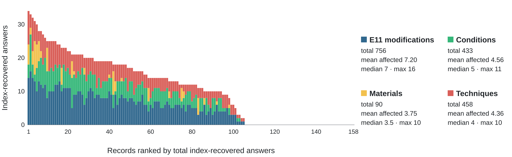
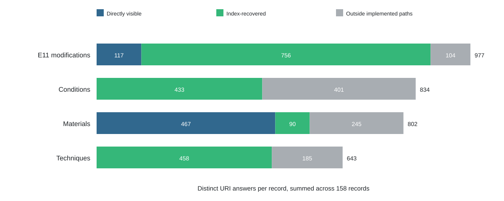

# Index-Recovered Answer Distribution

## Answer Families

| Answer family | Records affected | Index-recovered | Mean per affected record | Median per affected record | Max |
|---|---|---|---|---|---|
| E11 modifications | 105 | 756 | 7.20 | 7 | 16 |
| Conditions | 95 | 433 | 4.56 | 5 | 11 |
| Materials | 24 | 90 | 3.75 | 3.5 | 10 |
| Techniques | 105 | 458 | 4.36 | 4 | 10 |

## Conditions Outside the Index

| Classification | Conditions | Share |
|---|---|---|
| component_not_in_selected_p46_closure | 81 | 20.2% |
| component_p44_without_typed_e11_p31i | 320 | 79.8% |
| condition_attached_through_another_structure | 0 | 0.0% |
| another_e22_object_context | 0 | 0.0% |

## Unchanged Records

| Classification | Records | Share of unchanged |
|---|---|---|
| A_already_object_visible | 1 | 1.9% |
| B_no_eligible_indexed_content | 52 | 98.1% |
| C_component_evidence_duplicates_object_visible_uris | 0 | 0.0% |

The median uses the conventional definition over affected records only. For an even number of affected records, it is the arithmetic mean of the two central integer counts and may therefore be fractional.

## Concentration

| Rank | Record | Total recovered | Recovered E11 | Recovered conditions | Recovered materials | Recovered techniques |
|---|---|---|---|---|---|---|
| 1 | `bod:ArchBc4` | 34 | 14 | 4 | 6 | 10 |
| 2 | `bod:23197d1` | 33 | 16 | 11 | 2 | 4 |
| 3 | `bod:MSeMus65` | 32 | 14 | 4 | 4 | 10 |
| 4 | `bod:VetAld39` | 31 | 13 | 2 | 10 | 6 |
| 5 | `bod:ArchAf134` | 30 | 10 | 7 | 7 | 6 |
| 6 | `bod:AA106Art` | 28 | 13 | 6 | 6 | 3 |
| 7 | `bod:C822Line` | 28 | 12 | 8 | 2 | 6 |
| 8 | `loc:2966` | 27 | 11 | 7 | 0 | 9 |
| 9 | `tna:T20-1220` | 26 | 12 | 8 | 0 | 6 |
| 10 | `bod:MsAuctD417` | 25 | 8 | 8 | 7 | 2 |

## Trace Sources

The trace contains 1737 URI-level index-recovered answers. Every traced answer is reached through a declared P46 path. Component counts below are answer-component attribution incidences; one answer can contribute to several component types when it has multiple source paths.

### Leading Component Types

| Rank | Normalized component type | Attribution incidences |
|---|---|---|
| 1 | left board | 479 |
| 2 | textblock | 450 |
| 3 | right board | 429 |
| 4 | cover | 271 |
| 5 | left endleaves | 80 |
| 6 | sewing structure | 79 |
| 7 | right endleaves | 64 |
| 8 | spine-section | 56 |
| 9 | left-section | 25 |
| 10 | right-section | 23 |

### Index Rules

| Index rule | Index-recovered answers |
|---|---|
| e11_index_rule | 1304 |
| condition_index_rule | 433 |

### Index Dependence

All index-recovered answers depend on an index triple justified by a fully articulated P46 path.

| Query family | Records affected | URI-level recovered answers | Component attribution incidences | Component types |
|---|---|---|---|---|
| e11_modification | 105 | 756 | 756 | 13 |
| technique | 105 | 458 | 669 | 12 |
| condition | 95 | 433 | 433 | 12 |
| material | 24 | 90 | 139 | 13 |

By URI-level index-recovered magnitude, the families rank: E11 modifications (756), Techniques (458), Conditions (433), Materials (90). This is a distribution within the configured index-materialisation experiment, not a general measure of CIDOC CRM dependency.

## Object-Level Recall

| Query family | Fully articulated answers | Index-profile answers | Recall | Dark records | Dark / records with answers |
|---|---|---|---|---|---|
| e11_modification | 117 | 873 | 13.4% | 0 | 0.0% |
| condition | 0 | 433 | 0.0% | 95 | 100.0% |
| material | 467 | 557 | 83.8% | 21 | 21.6% |
| technique | 0 | 458 | 0.0% | 105 | 100.0% |

## Documented Answer Space

| Query family | Visible | Index-recovered | Outside paths | URI universe |
|---|---|---|---|---|
| e11_modification | 117 | 756 | 104 | 977 |
| condition | 0 | 433 | 401 | 834 |
| material | 467 | 90 | 245 | 802 |
| technique | 0 | 458 | 185 | 643 |

## P46 Path Depth

| Query family | Minimum P46 depth | Recovered answers |
|---|---|---|
| condition | 1 | 312 |
| condition | 2 | 121 |
| e11_modification | 1 | 493 |
| e11_modification | 2 | 263 |
| material | 1 | 41 |
| material | 2 | 49 |
| technique | 1 | 288 |
| technique | 2 | 170 |

Exact four-field trace groupings are in `trace_source_distribution.csv`; normalized component-type and family-specific distributions are separate CSVs. Normalization removes only a final parenthetical record-context suffix, folds case, and collapses whitespace.
